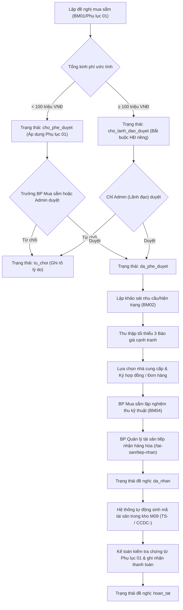
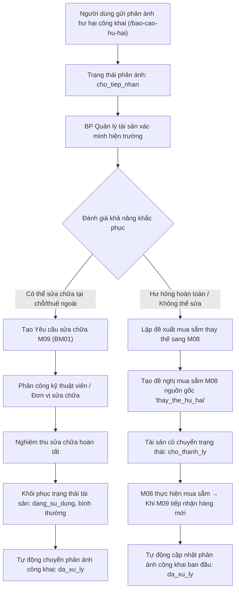

# AGENTS.md — Hướng dẫn cho AI Agent

> Tài liệu này mô tả toàn bộ quy ước, kiến trúc, quy trình nghiệp vụ và hướng dẫn hành vi bắt buộc dành cho AI Agent khi làm việc trong dự án **Website Quản lý Cơ sở Vật chất (NEU Facility Hub)**.  
> Nội dung đã được chuẩn hóa toàn diện dựa trên tài liệu nghiệp vụ chi tiết `Quy_trinh_M08_M09_M17_da_chinh_sua.txt`, văn bản pháp quy `PHỤ LỤC 01.docx`, và tài liệu liên kết 3 phân hệ `Yêu cầu 1.docx`.  
> Agent **phải đọc và tuân thủ** toàn bộ nội dung trong file này trước và trong quá trình thực hiện bất kỳ thay đổi nào.

---

## 1. Tổng quan dự án

| Mục | Nội dung |
|---|---|
| **Tên đề tài** | Xây dựng Website Quản lý Cơ sở Vật chất trường Đại học |
| **Mục tiêu** | Số hóa toàn diện và liên thông chu trình quản lý CSVC: **Đề xuất mua sắm (M08) → Tiếp nhận hàng hóa & Nghiệm thu → Phân loại nhập kho & Quản lý vòng đời tài sản / Sửa chữa (M09) → Kế toán thanh toán → Giám sát & Báo cáo quản trị (M17)** |
| **Công nghệ** | Python 3 (Flask), HTML5, CSS3, JavaScript (Bootstrap 5, Chart.js), SQLite (sqlite3 with row_factory), Jinja2, pytest |
| **Giao diện nhận diện** | Thiết kế chuẩn theo nhận diện thương hiệu của **Trường Đại học Kinh tế Quốc dân (NEU)**: tông màu xanh Navy (`#002D62`), xanh dương (`#0B4F9C`), đỏ điểm nhấn (`#C41230`), vàng kim (`#F5A623`), font Source Sans Pro / Roboto, logo NEU chính thức |
| **Ngôn ngữ giao diện** | Tiếng Việt chuẩn mực công vụ, rõ ràng, dễ hiểu |
| **Ngôn ngữ code** | Tiếng Việt cho tên biến nghiệp vụ, tên bảng CSDL, thông báo lỗi người dùng; tiếng Anh cho tên hàm kỹ thuật và cú pháp hạ tầng |

---

## 2. Đối tượng người dùng và phân quyền (RBAC Matrix)

Hệ thống được thiết kế chuyên biệt cho 4 vai trò nội bộ và 1 đối tượng công chúng. **Tuyệt đối không có vai trò người dùng nội bộ thông thường (`nguoi_dung`)**:

| Vai trò | Mã vai trò | Quyền hạn và phạm vi tác nghiệp |
|---|---|---|
| **Bộ phận Mua sắm** | `mua_sam` | - Lập đề nghị mua sắm mới (M08), khảo sát nhu cầu/hiện trạng (BM02), thu thập và chọn báo giá cạnh tranh (tối thiểu 3 báo giá), lập hồ sơ/hợp đồng mua sắm.<br>- **Phân cấp phê duyệt**: Trưởng bộ phận Mua sắm (`chuc_danh = 'truong_bo_phan'`) có thẩm quyền phê duyệt các đề nghị mua sắm có kinh phí **dưới 100 triệu đồng**.<br>- Cán bộ mua sắm thông thường không có quyền phê duyệt đề nghị. |
| **Bộ phận Quản lý tài sản** | `quan_ly_kho` | - Quản lý toàn bộ vòng đời tài sản (M09 - `/tai-san/`): cấp mã định danh TSCĐ / CCDC, quản lý bàn giao vị trí (BM03), kiểm kê định kỳ (BM05).<br>- **Chuyên trách tiếp nhận tài sản mới từ Mua sắm** ngay trong Phân hệ M09 (`/tai-san/tiep-nhan` & `/tai-san/tiep-nhan/<id>`): kiểm tra nghiệm thu kỹ thuật (BM04), cấp mã và nhập kho M09.<br>- **Tuyệt đối không truy cập Phân hệ Mua sắm (M08)**: Không có menu M08, không lập đề nghị mua sắm thủ công tại M08.<br>- **Tiếp nhận & xử lý phản ánh hư hại công khai**: Trực tiếp xác minh hiện trường, quyết định phương án **Sửa chữa** (lập phiếu sửa chữa M09, nghiệm thu phục hồi) hoặc **Thay thế** (lập đề xuất mua sắm thay thế chuyển sang M08). |
| **Kế toán** | `ke_toan` | - Quản lý hồ sơ thanh toán, kiểm tra chứng từ (hợp đồng/hóa đơn, biên bản nghiệm thu BM04, phiếu nhập kho).<br>- Xác nhận giải ngân thanh toán hoàn tất cho các gói mua sắm đã được tiếp nhận hàng hóa đầy đủ (`/ke-toan/`). |
| **Đơn vị sử dụng** | `don_vi` | - **Quản lý Yêu cầu Sửa chữa & Báo cáo Hư hại (M09)**: Lập phiếu chọn loại yêu cầu (sửa chữa nhỏ, thiết bị, công trình); theo dõi tiến độ thời gian thực (Mới gửi ➔ Khảo sát ➔ Thi công ➔ Nghiệm thu); ký xác nhận khảo sát BM03; ký nghiệm thu sửa chữa hoàn thành.<br>- **Quản lý Đề xuất Mua sắm & Dịch vụ mới (M08)**: Lập đề xuất BM01; theo dõi luồng phê duyệt; ký xác nhận khảo sát nhu cầu BM02; tham gia ký nghiệm thu hàng hóa.<br>- **Quản lý & Tra cứu Tài sản đơn vị (M09)**: Xác nhận ký nhận bàn giao tài sản mới từ QTTB (BM03); tra cứu danh mục tài sản nội bộ; xem lịch sử sửa chữa/bảo hành.<br>- **Phối hợp Kiểm kê & Nghiệm thu (M08 & M09)**: Phối hợp kiểm kê định kỳ; gửi giải trình chênh lệch số liệu kiểm kê.<br>- **Quyền hạn tác nghiệp**: Chỉ xem, gửi yêu cầu và ký xác nhận phối hợp; không can thiệp tác nghiệp chuyên môn của Mua sắm, Kho hay Kế toán. |
| **Quản trị viên (Admin / Lãnh đạo)** | `quan_tri` | - **Chỉ có quyền Phê duyệt và Giám sát**: Phê duyệt/từ chối các đề nghị mua sắm (bắt buộc duyệt các gói kinh phí **từ 100 triệu đồng trở lên**), quản lý tài khoản người dùng (`/admin/tai-khoan`).<br>- **Nguyên tắc ranh giới quyền hạn**: Đối với các phân hệ tác nghiệp chuyên môn (nhập hàng, bàn giao tài sản, nghiệm thu kỹ thuật, sửa chữa, giải ngân thanh toán), Admin **chỉ có quyền xem (giám sát)**, không được thực hiện tác nghiệp thay các phòng ban. |
| **Khách vãng lai** | _(chưa đăng nhập)_ | - Truy cập trang chủ (`/`), tra cứu thông tin chung, thực hiện đăng nhập (`/dang-nhap`) hoặc đăng ký tài khoản cán bộ đơn vị (`/dang-ky`). |

### Quy tắc phân quyền cốt lõi & Cơ chế định danh tự động:
1. **Cơ chế xác thực tài khoản khi lập phiếu**:
   - **Thông tin người đề nghị**: Hệ thống tự động ghi nhận theo tài khoản đăng nhập hiện tại (`session['ho_ten']`, `session['nguoi_dung_id']`).
   - **Thông tin đơn vị đề nghị**: Hệ thống tự động gán Đơn vị tương ứng với phòng/ban/khoa mà tài khoản đại diện (`session['don_vi']`).
   - **Tự động sinh mã phiếu**: Tự động cấp mã chuẩn công vụ ngay khi bấm gửi (`YC-YYYYMMDD-XXX` cho sửa chữa, `DN-YYYYMMDD-XXX` cho đề xuất mua sắm).
2. **Loại bỏ việc gửi phản ánh ẩn danh ngoài luồng**: Cán bộ, giảng viên có danh tính đăng nhập theo phòng ban công tác riêng để theo dõi tiến độ xử lý và ký biên bản điện tử liên thông.
3. **Xóa hoàn toàn nút báo cáo hư hại ở Trang chủ**: Do nghiệp vụ hiện tại đã có tài khoản Đơn vị sử dụng (`don_vi`) đại diện phòng ban công tác để báo hỏng và theo dõi tiến độ sửa chữa thời gian thực, nút báo cáo hư hại vật chất công khai ở Trang chủ đã được xóa bỏ hoàn toàn để chuẩn hóa luồng tiếp nhận chính quy.
4. **Ngưỡng thẩm quyền 100 triệu đồng**:
   - Gói `< 100,000,000 VNĐ`: Trạng thái `cho_phe_duyet` → Trưởng BP Mua sắm hoặc Admin có thể duyệt.
   - Gói `≥ 100,000,000 VNĐ`: Trạng thái `cho_lanh_dao_duyet` → Bắt buộc Admin (Lãnh đạo) duyệt; Cán bộ hoặc Trưởng BP Mua sắm cố tình duyệt sẽ bị chặn mã HTTP 403 `KHONG_DU_QUYEN`.
5. **Phân định rõ ràng Mua sắm, Quản lý tài sản và Đơn vị sử dụng**:
   - `mua_sam`: Phụ trách lập đề nghị, thương thảo, khảo sát, báo giá, hợp đồng, theo dõi tiến độ cung ứng (M08).
   - `quan_ly_kho`: Phụ trách toàn bộ vòng đời tài sản (M09), tiếp nhận tài sản mới từ Mua sắm tại `/tai-san/tiep-nhan`, cấp mã TSCĐ/CCDC, theo dõi hiện trường, bảo trì sửa chữa. Cán bộ QLTS tuyệt đối không vào phân hệ M08.
   - `don_vi`: Đơn vị thụ hưởng cơ sở vật chất, tra cứu tài sản của mình, lập đề xuất nhu cầu, theo dõi tiến độ và ký xác nhận phối hợp. Tuyệt đối không can thiệp tác nghiệp chuyên môn của Mua sắm hay Kho.

---

## 3. Quy chế Mua sắm theo PHỤ LỤC 01 & Phân cấp Hợp đồng

Dựa trên văn bản **PHỤ LỤC 01** *(Danh mục mua sắm hàng hóa, dịch vụ, sửa chữa có giá không quá 100 triệu đồng không bắt buộc ký hợp đồng bằng văn bản riêng)*:

### 3.1 Nhóm danh mục mua sắm và sửa chữa:
- **Nhóm A — Hàng hóa, vật tư, CCDC**:
  - Văn phòng phẩm, vật tư tiêu hao, mực in, giấy in.
  - Vật tư điện thông dụng (bóng đèn, công tắc, ổ cắm, dây điện).
  - Vật tư cấp thoát nước (vòi, van, phao, xi-phông).
  - Phụ kiện công nghệ thông tin (chuột, bàn phím, webcam, RAM, SSD, dây cáp mạng/HDMI).
  - Công cụ, dụng cụ nhỏ (kìm, tua vít, thang nhôm, hộp đồ nghề).
  - Hàng hóa bán sẵn (quạt, ấm điện, điện thoại bàn, bàn ghế học đường bán sẵn giao một lần).
  - Vật tư phòng lab, phòng thực hành (cảm biến, linh kiện điện tử, dây kết nối).
- **Nhóm B — Sửa chữa nhỏ, bảo dưỡng thiết bị**:
  - Bảo dưỡng điều hòa nhiệt độ, nạp gas, vệ sinh dàn lạnh/dàn nóng.
  - Sửa chữa máy in, máy chiếu, thiết bị âm thanh hội thảo.
  - Sửa chữa điện, nước nhỏ; thông tắc cục bộ; thay thế phụ kiện cửa, ổ khóa, thẻ từ.

### 3.2 Quy định ký kết hợp đồng & Thẩm quyền duyệt:
- **Gói kinh phí $\le$ 100,000,000 VNĐ (Áp dụng Phụ lục 01)**:
  - **Không bắt buộc ký hợp đồng bằng văn bản riêng**.
  - Có thể sử dụng: Đơn đặt hàng / Báo giá được duyệt + Biên bản bàn giao, nghiệm thu + Hóa đơn điện tử hợp lệ.
  - **Thẩm quyền phê duyệt**: Trưởng bộ phận Mua sắm (`chuc_danh = 'truong_bo_phan'`) hoặc Lãnh đạo Trường.
- **Gói kinh phí > 100,000,000 VNĐ**:
  - **Bắt buộc ký Hợp đồng kinh tế bằng văn bản riêng** và lập kế hoạch lựa chọn nhà thầu.
  - **Thẩm quyền phê duyệt**: Bắt buộc **Lãnh đạo Trường (Admin)** xem xét và phê duyệt.

### 3.3 Danh mục hồ sơ tối thiểu cho Kế toán thanh toán (Mục IV Phụ lục 01):
1. Phiếu đề nghị mua sắm hoặc yêu cầu sửa chữa đã được cấp thẩm quyền phê duyệt.
2. Mô tả quy cách hàng hóa, phạm vi công việc kèm Báo giá cạnh tranh (tối thiểu 3 báo giá độc lập) hoặc giá niêm yết.
3. Hợp đồng kinh tế (nếu gói > 100 triệu) hoặc Đơn đặt hàng có xác nhận (nếu gói $\le$ 100 triệu).
4. Biên bản kiểm tra, nghiệm thu kỹ thuật (BM04) và Phiếu tiếp nhận hàng hóa vào kho M09.
5. Hóa đơn tài chính điện tử hợp pháp của Nhà cung cấp (ghi đúng mã số thuế, tên Trường ĐH Kinh tế Quốc dân).
6. Chứng từ giải ngân, lệnh chuyển khoản qua Kho bạc / Ngân hàng.

---

## 4. Kiến trúc luồng nghiệp vụ liên thông (M08 ⇄ M09 ⇄ M17)

### 4.1 Quy trình Mua sắm tài sản & vật tư (M08)


### 4.2 Quy trình Xử lý sự cố hư hại & Quản lý vòng đời tài sản (M09)


### 4.3 Quy tắc phân loại mã tài sản thông minh
- **Tài sản cố định (TSCĐ)**: Đơn giá $\ge$ 10,000,000 VNĐ.
  - Phân loại: `tai_san_co_dinh`
  - Tiền tố mã tài sản: `TS-YYYY-XXXX` (Ví dụ: `TS-2026-0001`)
- **Công cụ dụng cụ (CCDC)**: Đơn giá < 10,000,000 VNĐ.
  - Phân loại: `cong_cu_dung_cu`
  - Tiền tố mã tài sản: `CCDC-YYYY-XXXX` (Ví dụ: `CCDC-2026-0001`)

---

## 5. Danh mục quy tắc nghiệp vụ bắt buộc (BR01 – BR12)

| Mã luật | Nội dung chi tiết |
|---|---|
| **BR01** | **Ngưỡng duyệt kinh phí**: Đề nghị < 100tr do Trưởng BP Mua sắm hoặc Admin duyệt; đề nghị $\ge$ 100tr bắt buộc Admin duyệt. |
| **BR02** | **Ranh giới tác nghiệp của Admin**: Admin chỉ có quyền Duyệt đề nghị $\ge$ 100tr và Quản lý tài khoản. Admin tuyệt đối không tiếp nhận hàng, không bàn giao tài sản, không giải ngân thanh toán, không trực tiếp sửa chữa. |
| **BR03** | **Khảo sát nhu cầu (BM02)**: Trước khi mua sắm số lượng lớn, BP Mua sắm lập phiếu khảo sát ghi nhận hiện trạng và mức độ cấp thiết. |
| **BR04** | **Quy tắc 3 báo giá cạnh tranh**: Mỗi gói mua sắm phải thu thập tối thiểu 3 báo giá từ các nhà cung cấp độc lập trước khi lựa chọn. |
| **BR05** | **Nghiệm thu kỹ thuật (BM04)**: Hàng hóa giao đến phải được lập biên bản kiểm tra đạt yêu cầu kỹ thuật mới được nhập kho. |
| **BR06** | **Tiếp nhận tài sản mới từ Mua sắm (M09)**: Bộ phận Quản lý tài sản kiểm tra nghiệm thu kỹ thuật và tiếp nhận nhập kho M09 tại `/tai-san/tiep-nhan`. **Chỉ hiển thị các đề nghị đã được nghiệm thu kỹ thuật đạt (BM04)**, đủ điều kiện tiếp nhận vào kho M09. Khi xác nhận tiếp nhận, hệ thống tự động sinh mã định danh (TSCĐ `TS-YYYY-XXXX` / CCDC `CCDC-YYYY-XXXX`) với trạng thái `cho_ban_giao`. Tuyệt đối không có nút đề xuất mua sắm thủ công trong M09. |
| **BR07** | **Điều kiện thanh toán kế toán**: Kế toán chỉ được duyệt giải ngân cho các đề nghị mua sắm đã có trạng thái `da_nhan` (đã tiếp nhận hàng và nghiệm thu đầy đủ theo Mục IV Phụ lục 01). |
| **BR08** | **Báo cáo hư hại hoàn toàn công khai**: Bất kỳ ai cũng có thể gửi phản ánh tại `/bao-cao-hu-hai` mà không cần tài khoản, mật khẩu hay captcha. |
| **BR09** | **Ẩn nút báo cáo hư hại khi đã đăng nhập**: Trang chủ và toàn bộ navbar không hiển thị nút báo cáo sự cố khi phiên làm việc đã đăng nhập. |
| **BR10** | **Phân nhánh xử lý hư hại**: BP Quản lý tài sản xác minh: nếu sửa chữa được → tạo yêu cầu sửa chữa M09; nếu hỏng nặng cần thay thế → tự động sinh đề nghị mua sắm mới M08 liên kết với phản ánh. |
| **BR11** | **Tự động khép hồ sơ phản ánh**: Khi ca sửa chữa M09 được nghiệm thu HOẶC đề nghị mua sắm thay thế M08 được tiếp nhận hàng, phản ánh hư hại công khai tự động chuyển thành `da_xu_ly`. |
| **BR12** | **Kiểm kê chênh lệch**: Phiếu kiểm kê M09 phải ghi nhận rõ số lượng hệ thống, số lượng thực tế, tự động tính chênh lệch và trạng thái thừa/thiếu/khớp. |

---

## 6. Kiến trúc trang và hệ thống Endpoint

### 6.1 Danh mục Blueprint & Routes

```
/ (main)
├── GET  /                              # Trang chủ NEU Facility Hub (Công khai)
├── GET  /bao-cao-hu-hai                # Form công khai gửi phản ánh sự cố
├── POST /bao-cao-hu-hai                # Xử lý tiếp nhận phản ánh hư hại
└── GET  /cam-on                        # Trang thông báo gửi phản ánh thành công

/auth (auth)
├── GET/POST /dang-nhap                 # Đăng nhập hệ thống (Phân hướng tự động theo vai trò)
├── GET/POST /dang-ky                   # Đăng ký tài khoản cán bộ đơn vị
└── GET      /dang-xuat                 # Đăng xuất phiên làm việc

/mua-sam (mua_sam) - Yêu cầu: mua_sam | quan_tri (xem/duyệt)
├── GET       /mua-sam/                 # Danh sách đề nghị mua sắm
├── GET/POST  /mua-sam/de-nghi/tao      # Lập đề nghị mua sắm mới (BM01/Phụ lục 01)
├── GET       /mua-sam/de-nghi/<id>     # Chi tiết đề nghị, khảo sát, báo giá, nghiệm thu
├── POST      /mua-sam/de-nghi/<id>/phe-duyet # Phê duyệt (Kiểm tra thẩm quyền 100tr)
├── POST      /mua-sam/de-nghi/<id>/tu-choi   # Từ chối đề nghị kèm lý do
├── POST      /mua-sam/de-nghi/<id>/khao-sat  # Lập phiếu khảo sát hiện trạng (BM02)
├── POST      /mua-sam/de-nghi/<id>/bao-gia   # Thêm báo giá nhà cung cấp
├── POST      /mua-sam/de-nghi/<id>/chon-bao-gia # Lựa chọn báo giá trúng thầu
├── POST      /mua-sam/de-nghi/<id>/nghiem-thu   # Lập biên bản nghiệm thu kỹ thuật (BM04)
└── GET       /mua-sam/ho-so            # Danh mục hợp đồng và hồ sơ mua sắm

/ke-toan (ke_toan) - Yêu cầu: ke_toan | quan_tri (chỉ xem)
├── GET   /ke-toan/                     # Danh sách đề nghị chờ thanh toán
├── GET   /ke-toan/de-nghi/<id>         # Chi tiết chứng từ thanh toán & checklist Phụ lục 01
├── POST  /ke-toan/de-nghi/<id>/thanh-toan # Ghi nhận giải ngân thanh toán hoàn tất
└── GET   /ke-toan/lich-su              # Lịch sử các đợt giải ngân

/tai-san (tai_san) - Yêu cầu: quan_ly_kho | quan_tri (chỉ xem)
├── GET       /tai-san/                 # Danh mục tài sản & CCDC toàn trường
├── GET       /tai-san/<id>             # Chi tiết tài sản, lịch sử bàn giao & bảo trì
├── GET/POST  /tai-san/<id>/chinh-sua   # Cập nhật thông tin thông số kỹ thuật
├── POST      /tai-san/<id>/ban-giao    # Bàn giao tài sản cho đơn vị/phòng học (BM03)
├── GET/POST  /tai-san/<id>/bao-tri     # Ghi nhận bảo trì trực tiếp trên tài sản
├── GET       /tai-san/tiep-nhan        # Danh sách gói mua sắm chờ tiếp nhận vào kho M09
├── GET/POST  /tai-san/tiep-nhan/<id>   # Xác nhận tiếp nhận hàng hóa & cấp mã tài sản vào kho M09
├── GET       /tai-san/sua-chua         # Quản lý toàn diện các ca sửa chữa M09
├── POST      /tai-san/sua-chua/<id>/nghiem-thu # Nghiệm thu sửa chữa phục hồi
├── GET       /tai-san/kiem-ke          # Danh sách phiếu kiểm kê tài sản (BM05)
├── POST      /tai-san/kiem-ke/tao      # Lập đợt kiểm kê tài sản mới
├── GET       /tai-san/bao-cao-hu-hai   # Tiếp nhận phản ánh hư hại công khai
├── POST      /tai-san/bao-cao-hu-hai/<id>/xu-ly # Xác minh: Sửa chữa hoặc Thay thế
└── POST      /tai-san/bao-cao-hu-hai/<id>/tao-mua-sam # Lập đề xuất mua sắm thay thế sang M08

/don-vi (don_vi) - Yêu cầu: don_vi | quan_tri (chỉ xem)
├── GET       /don-vi/                  # Bảng điều khiển trung tâm của Đơn vị sử dụng
├── GET       /don-vi/dashboard         # Tổng quan tài sản, sự cố, đề xuất của đơn vị
├── GET       /don-vi/sua-chua          # Danh sách yêu cầu sửa chữa thiết bị của đơn vị
├── GET/POST  /don-vi/sua-chua/tao      # Lập phiếu báo hỏng / Yêu cầu sửa chữa (tự động điền danh tính)
├── GET       /don-vi/sua-chua/<id>     # Theo dõi tiến độ sửa chữa thời gian thực
├── POST      /don-vi/sua-chua/<id>/xac-nhan-khao-sat # Ký xác nhận khảo sát hiện trường (BM03)
├── POST      /don-vi/sua-chua/<id>/nghiem-thu # Ký nghiệm thu hoàn thành sửa chữa
├── GET       /don-vi/mua-sam           # Danh sách đề xuất mua sắm của đơn vị
├── GET/POST  /don-vi/mua-sam/tao       # Lập phiếu đề xuất mua sắm mới (BM01)
├── GET       /don-vi/mua-sam/<id>      # Xem tiến độ duyệt đề xuất mua sắm
├── POST      /don-vi/mua-sam/<id>/xac-nhan-khao-sat # Ký xác nhận khảo sát nhu cầu (BM02)
├── POST      /don-vi/mua-sam/<id>/nghiem-thu # Tham gia ký nghiệm thu hàng hóa mua sắm
├── GET       /don-vi/tai-san           # Danh mục tài sản nội bộ do đơn vị quản lý
├── GET       /don-vi/tai-san/<id>      # Chi tiết lý lịch tài sản, lịch sử sửa chữa/bảo hành
├── POST      /don-vi/tai-san/<id>/xac-nhan-ban-giao # Ký nhận bàn giao tài sản mới từ QTTB (BM03)
├── GET       /don-vi/kiem-ke           # Danh sách các đợt kiểm kê tài sản liên quan đến đơn vị
└── POST      /don-vi/kiem-ke/<id>/giai-trinh # Gửi văn bản giải trình chênh lệch kiểm kê

/admin (admin) - Yêu cầu: quan_tri (Lãnh đạo / Admin)
├── GET   /admin/                       # Dashboard M17: KPI, biểu đồ Chart.js
├── GET   /admin/mua-sam                # Trung tâm phê duyệt đề nghị mua sắm
├── GET   /admin/tai-san                # Giám sát toàn bộ kho tài sản (chỉ xem)
├── GET   /admin/bao-cao                # Báo cáo tổng hợp, xuất dữ liệu CSV
├── GET   /admin/bao-cao-hu-hai         # Giám sát tiến độ xử lý phản ánh (chỉ xem)
├── GET   /admin/tai-khoan              # Quản lý tài khoản người dùng
└── POST  /admin/tai-khoan/<id>/doi-vai-tro # Cập nhật vai trò / chức danh
```

### 6.2 Điều hướng tự động sau đăng nhập (Login Redirection)
```
vai_tro == "don_vi"       → /don-vi/    (Bảng điều khiển Đơn vị sử dụng)
vai_tro == "mua_sam"      → /mua-sam/   (Trang công việc Mua sắm M08)
vai_tro == "quan_ly_kho"  → /tai-san/   (Trang Quản lý tài sản M09)
vai_tro == "ke_toan"      → /ke-toan/   (Trang thanh toán Kế toán)
vai_tro == "quan_tri"     → /admin/     (Admin Dashboard M17)
```

---

## 7. Kiến trúc cơ sở dữ liệu (Database Schema)

Cơ sở dữ liệu SQLite (`csvc.db`) gồm 13 bảng nghiệp vụ chuẩn hóa:

1. `nguoi_dung`: `id`, `ten_dang_nhap`, `mat_khau_hash`, `ho_ten`, `email`, `don_vi`, `vai_tro`, `chuc_danh` (`truong_bo_phan`, `can_bo`), `ngay_tao`.
2. `de_nghi_mua_sam`: `id`, `ma_de_nghi`, `tieu_de`, `nguoi_de_nghi_id`, `nguon_goc` (`de_xuat_moi`, `thay_the_hu_hai`), `bao_cao_hu_hai_id`, `muc_do_uu_tien`, `nguon_kinh_phi`, `thoi_gian_can_hang`, `dia_diem_su_dung`, `ly_do_su_can_thiet`, `tong_tien_uoc_tinh`, `trang_thai` (`cho_phe_duyet`, `cho_lanh_dao_duyet`, `da_phe_duyet`, `tu_choi`, `dang_mua`, `da_nhan`, `hoan_tat`), `nguoi_duyet_id`, `ngay_duyet`, `ly_do_tu_choi`, `so_hop_dong`, `nha_cung_cap`, `gia_tri_hop_dong`, `da_nghiem_thu`, `ngay_nghiem_thu`, `ghi_chu_nghiem_thu`, `ngay_tao`.
3. `chi_tiet_de_nghi`: `id`, `de_nghi_id`, `ten_hang_hoa`, `don_vi_tinh`, `so_luong`, `don_gia_du_kien`, `thanh_tien`, `vi_tri_su_dung`, `ly_do_muc_dich`, `ghi_chu`.
4. `khao_sat_nhu_cau`: `id`, `ma_khao_sat`, `de_nghi_id`, `nguoi_khao_sat_id`, `ngay_khao_sat`, `noi_dung`, `dia_diem`, `can_bo_khao_sat`, `dai_dien_don_vi`, `ket_qua_danh_gia`, `kiem_tra_kho`, `doi_chieu_dinh_muc`, `muc_do_can_thiet`, `phuong_an_de_xuat`, `ket_luan`, `ngay_tao`.
5. `bao_gia`: `id`, `de_nghi_id`, `nha_cung_cap`, `ma_so_thue`, `lien_he`, `tong_gia`, `hieu_luc`, `ghi_chu`, `duoc_chon`, `ngay_tao`.
6. `nghiem_thu_mua_sam`: `id`, `ma_nghiem_thu`, `de_nghi_id`, `nguoi_nghiem_thu_id`, `ngay_nghiem_thu`, `dai_dien_ben_mua`, `dai_dien_nha_cung_cap`, `dai_dien_don_vi_su_dung`, `ket_qua`, `y_kien_danh_gia`, `ngay_tao`.
7. `tai_san`: `id`, `ma_tai_san`, `ten_tai_san`, `loai_tai_san`, `phan_loai` (`tai_san_co_dinh`, `cong_cu_dung_cu`), `so_serial`, `model`, `hang_san_xuat`, `thoi_han_bao_hanh`, `ngay_tiep_nhan`, `gia_tri`, `vi_tri`, `phong_ban`, `don_vi_su_dung`, `trang_thai` (`cho_ban_giao`, `dang_su_dung`, `dang_sua_chua`, `cho_thanh_ly`, `da_thanh_ly`), `tinh_trang_ky_thuat` (`binh_thuong`, `co_hu_hong`, `can_kiem_tra`), `de_nghi_mua_sam_id`, `nguoi_tiep_nhan_id`, `mo_ta`.
8. `lich_su_ban_giao`: `id`, `tai_san_id`, `ngay_ban_giao`, `nguoi_ban_giao_id`, `nguoi_nhan_id`, `vi_tri_moi`, `ghi_chu`.
9. `lich_su_bao_tri`: `id`, `tai_san_id`, `ngay_bao_tri`, `noi_dung`, `chi_phi`, `don_vi_thuc_hien`, `ghi_chu`, `trang_thai_moi`, `nguoi_tao_id`.
10. `yeu_cau_sua_chua`: `id`, `ma_sua_chua`, `tai_san_id`, `bao_cao_hu_hai_id`, `nguoi_tao_id`, `ngay_yeu_cau`, `mo_ta_hu_hong`, `muc_do_uu_tien`, `phuong_an_sua_chua`, `don_vi_sua_chua`, `du_toan_kinh_phi`, `chi_phi_thuc_te`, `trang_thai` (`cho_sua_chua`, `dang_sua_chua`, `hoan_thanh`, `khong_the_sua`), `ket_qua_nghiem_thu`, `ngay_hoan_thanh`, `ghi_chu`.
11. `kiem_ke`: `id`, `ma_phieu`, `ngay_kiem_ke`, `nguoi_kiem_ke_id`, `ky_kiem_ke`, `ghi_chu`.
12. `chi_tiet_kiem_ke`: `id`, `phieu_kiem_ke_id`, `tai_san_id`, `tinh_trang`, `ghi_chu`.
13. `bao_cao_hu_hai`: `id`, `ho_ten_nguoi_gui`, `thong_tin_lien_he`, `vi_tri`, `ten_thiet_bi`, `muc_do`, `mo_ta`, `trang_thai` (`cho_tiep_nhan`, `dang_xu_ly`, `da_xu_ly`, `tu_choi`), `phuong_an_xu_ly` (`sua_chua`, `thay_the`, `tu_choi`), `nguoi_xu_ly_id`, `ngay_xu_ly`, `ghi_chu_xu_ly`, `de_nghi_mua_sam_id`, `tai_san_id`, `ngay_tao`.

---

## 8. Danh mục tài khoản mẫu kiểm thử

Hệ thống được thiết lập sẵn 7 tài khoản mẫu chuẩn để phục vụ kiểm thử và nghiệm thu:

| Vai trò | Tên đăng nhập | Mật khẩu | Chức danh / Đơn vị | Thẩm quyền đặc thù |
|---|---|---|---|---|
| **Quản trị viên (Admin / Lãnh đạo)** | `admin` | `admin123` | Lãnh đạo Trường | Duyệt đề nghị $\ge$ 100tr, quản lý tài khoản; các phân hệ khác chỉ xem giám sát |
| **Trưởng BP Mua sắm** | `truongmuasam` | `muasam1234` | Trưởng bộ phận | Phê duyệt đề nghị mua sắm kinh phí dưới 100 triệu VNĐ |
| **Cán bộ Mua sắm** | `cb_muasam` | `password123` | Cán bộ Mua sắm | Lập đề nghị mua sắm, lập khảo sát BM02, thêm báo giá |
| **Quản lý tài sản** | `cb_kho` | `password123` | Cán bộ QLTS | Nghiệm thu hàng BM04, tiếp nhận vào kho M09, xử lý phản ánh hư hại, quản lý sửa chữa (không vào M08) |
| **Kế toán** | `cb_ketoan` | `password123` | Kế toán viên | Kiểm tra chứng từ theo Phụ lục 01, xác nhận thanh toán giải ngân |
| **Đơn vị sử dụng (Khoa CNTT)** | `gv_khoacntt` | `password123` | Phó Trưởng Khoa CNTT | Báo hỏng thiết bị, theo dõi sửa chữa thời gian thực, lập đề xuất BM01, ký bàn giao BM03, giải trình kiểm kê |
| **Đơn vị sử dụng (Khoa QTKD)** | `gv_khoaqtkd` | `password123` | Giảng viên Khoa QTKD | Tài khoản đơn vị sử dụng thứ 2 phục vụ kiểm thử phân chia dữ liệu theo khoa |

---

## 9. Hướng dẫn lệnh (Commands)

### 9.1 Cài đặt dependencies
```bash
pip install -r requirements.txt
```

### 9.2 Khởi tạo cơ sở dữ liệu và nạp dữ liệu mẫu
```bash
python scripts/du_lieu_mau.py
```

### 9.3 Chạy ứng dụng web
```bash
python run.py
```
Ứng dụng khả dụng tại địa chỉ: **`http://127.0.0.1:5000`**

### 9.4 Chạy bộ kiểm thử tự động
```bash
pytest -v
```

---

## 10. Checklist kiểm tra bắt buộc cho AI Agent

Mỗi khi chỉnh sửa hoặc nâng cấp bất kỳ tính năng nào, AI Agent phải kiểm tra và xác nhận:
- [ ] **Phân định 5 vai trò hệ thống**: `quan_tri`, `mua_sam`, `quan_ly_kho`, `ke_toan`, `don_vi`. Tuyệt đối không dùng vai trò chung chung `nguoi_dung`.
- [ ] **Định danh tự động cho Đơn vị sử dụng**: Tự động điền họ tên, phòng ban từ phiên đăng nhập; tự động sinh mã phiếu `YC-...` và `DN-...`.
- [ ] **Tuân thủ quy chế Phụ lục 01**: Gói kinh phí $\le$ 100 triệu không bắt buộc ký hợp đồng bằng văn bản riêng; Trưởng BP Mua sắm có thẩm quyền duyệt.
- [ ] **Phân cấp duyệt 100 triệu**: Đề nghị $\ge$ 100 triệu VNĐ chỉ có `quan_tri` duyệt được và bắt buộc ký hợp đồng bằng văn bản riêng; Trưởng BP Mua sắm chỉ duyệt được gói < 100 triệu.
- [ ] **Ranh giới quyền hạn nghiêm ngặt**: Admin chỉ duyệt đề nghị và quản lý tài khoản; Đơn vị sử dụng chỉ xem, gửi yêu cầu và ký xác nhận phối hợp, bị chặn HTTP 403 ở các phân hệ tác nghiệp chuyên môn.
- [ ] **Nút báo cáo hư hại**: Đã xóa hoàn toàn khỏi Trang chủ; mọi yêu cầu báo hỏng được thực hiện chuẩn quy qua tài khoản Đơn vị sử dụng (`don_vi`).
- [ ] **Phân loại tài sản**: Đơn giá $\ge$ 10tr tạo `TS-YYYY-XXXX` (`tai_san_co_dinh`); đơn giá < 10tr tạo `CCDC-YYYY-XXXX` (`cong_cu_dung_cu`).
- [ ] **Chu trình sửa chữa M09**: Lập yêu cầu -> Khảo sát BM03 -> Thi công -> Nghiệm thu sửa chữa -> Khôi phục `dang_su_dung`, tình trạng `binh_thuong`, chuyển phản ánh sang `da_xu_ly`.
- [ ] **Kiến trúc MVC nghiêm ngặt**: Route không chứa SQL, toàn bộ logic nghiệp vụ đặt trong `services/`, thời gian lấy qua `clock.now()`.
- [ ] **Phân quyền tuyệt đối**: Cán bộ Quản lý tài sản không truy cập `/mua-sam/`; nghiệp vụ tiếp nhận tài sản mới từ Mua sắm được thực hiện ngay trong Phân hệ M09 (`/tai-san/tiep-nhan`).
- [ ] **Toàn bộ 32 test cases vượt qua thành công**: `pytest -v` phải đạt 100% Passed.
